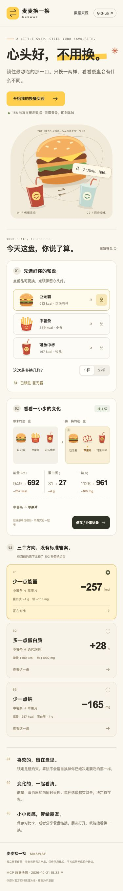

<div align="center">

# 麦麦换一换 · McSwap

**心头好，不用换。**

锁住最想吃的那一口，只换一两样，看清整盘的变化。

[立即体验](https://drt2222.github.io/mcswap/) · [真实 MCP 接入](MCP_INTEGRATION.md) · [计算方法](#怎么计算) · [本地运行](#本地运行)

</div>



## 30 秒体验

1. 打开 [在线餐盘实验室](https://drt2222.github.io/mcswap/)，无需登录或 Token。
2. 默认是「巨无霸 + 中薯条 + 可乐中杯」，巨无霸已经锁住；也可以搜索挑选自己的三样餐品。
3. 选择最多换 1 样或 2 样，对比「少一点能量」「多一点蛋白质」「少一点钠」。
4. 保存 PNG 对比卡或复制餐盘链接。朋友打开后能还原你的选择，并继续编辑。

适合已经知道自己想吃什么、希望了解替换后营养变化的人，也适合想复现真实 MCP 数据处理与约束搜索的开发者。

## 一盘真实例子

当前官方 MCP 快照：160 条原始记录、158 款去重餐品。抓取时间见页面与 [数据文件](public/data/nutrition.json)，不代表门店当前供应或配方最近更新时间。

保留巨无霸，最多换 1 样：

| 餐盘 | 能量 kcal | 蛋白质 g | 钠 mg |
|---|---:|---:|---:|
| 巨无霸 + 中薯条 + 可乐中杯 | 949 | 31 | 1126 |
| 薯条换成苹果片 | 692（−257） | 27（−4） | 961（−165） |
| 薯条换成绝代双翅 | 1129（+180） | 59（+28） | 2128（+1002） |

**蛋白质更多，也可能带来更多能量和钠。** 所以页面同时展示全部三个指标，不将单一指标改善称为“更健康”，不替用户作健康判断。不同餐品规格、口味和价格也不等价。

## 做了什么

- **偏好是硬约束**：被锁住的餐品绝不参与自动替换。
- **可解释的有限改变**：最多换两格，列出从哪一款换成哪一款。
- **三个独立目标**：每个方向分别优化，附带其他指标变化；无解明确告知。
- **真实、可追溯数据**：真实调用官方 MCP，公开必要营养字段与时间，失败不伪造数据。
- **零登录演示**：静态网页，无后端账户、无需语言模型服务；计算在浏览器本地完成。
- **可复现分享**：链接带原餐盘、锁定、替换上限和展示方案；PNG 也附来源与限制。
- **桌面与手机可用**：响应式布局、键盘操作、原生弹窗与减少动画支持。

## 本地运行

需要 **Node.js 22+**。

```sh
git clone https://github.com/drt2222/mcswap.git
cd mcswap
npm ci
npm run dev
```

打开终端显示的本机地址。仓库内包含真实快照，直接运行不需要 Token。

```sh
npm test        # 数据解析、约束搜索、分享还原测试
npm run build  # TypeScript 检查 + 生产构建
npm run preview
```

构建输出为 `dist/`，可部署到静态托管。在线演示由 GitHub Pages 的 `gh-pages` 分支托管，发布前在本地完成测试和构建；部署不需要麦当劳 Token。

### 用自己的 Token 更新营养数据

在 [麦当劳开放平台](https://open.mcd.cn/mcp) 申请 Token，然后：

```sh
cp .env.example .env.local
# 用编辑器填写 MCD_MCP_TOKEN=，不要将 Token 发给他人或提交到 Git
npm run sync
```

同步会完成真实 MCP 握手与 `list-nutrition-foods` 调用。数据全部通过验证后才覆盖旧快照；HTTP、接口或解析异常时明确失败并保留旧数据。详见 [MCP_INTEGRATION.md](MCP_INTEGRATION.md)。

## 怎么计算

三格餐盘，每格可锁定。候选来自当前快照、与原餐品具有同一本地粗分类的餐品。算法枚举所有满足锁定与替换上限的组合，分别找到：

- 总能量最小且低于原餐盘的方案；
- 总蛋白质最大且高于原餐盘的方案；
- 总钠最小且低于原餐盘的方案。

主指标并列时，先选变化格数更少的方案，再比较其他指标的不利变化：`增加能量 / 500 + 减少蛋白质 / 25 + 增加钠 / 1000`。分母只是平局排序的工程尺度，不是营养学标准。仍相同则保持快照遍历顺序。源码见 [src/engine.mjs](src/engine.mjs)。测试用独立穷举结果对照算法，并覆盖全部 8 种锁定组合和两种替换上限。

数据不齐全时不补零。完全相同的重复餐品合并；同名数值冲突时停止同步。稳定餐品 ID 来自名称哈希。分享链接会验证餐品 ID、类别、锁定与变化上限；它复用接收端的当前快照，跨快照数值可能更新，并非永久存档。

## 边界与来源

- 营养数值：官方 `https://mcp.mcd.cn` 的 `list-nutrition-foods`。
- 单位与单份口径：[麦当劳官方营养计算器](https://www.mcdonalds.com.cn/nutrition_calculator)。
- 分类由本项目按餐品名整理，不是官方分类；同类别不保证同价格、同口味、同供应时段。更小规格也可能被选中。
- 不判断过敏原、医疗状况、饮食禁忌、饱腹感或个人所需摄入量；不提供营养处方。
- 不读取账户、优惠券、订单或位置，不自动领券、下单或支付。浏览器端不收集餐盘数据，也不使用第三方统计脚本。
- SVG 插画为本项目绘制的示意图，并非实物照片或麦当劳官方素材。

## 项目结构

```text
src/engine.mjs           约束搜索、分类、分享编码
src/main.ts             交互界面、Canvas 对比卡
src/art.ts              原创 SVG 示意插画
scripts/sync.mjs         真实 MCP 同步
scripts/nutrition.mjs    响应解析与公开字段筛选
public/data/            带来源时间的营养快照
tests/                  可离线运行的 Node 测试
```

## 开源与参赛

本项目为 [麦当劳程序员创意开发大赛](https://github.com/M-China/mcd-developer-innovation-challenge) 的独立参赛作品，非麦当劳官方产品。原创代码与插画采用 [MIT License](LICENSE)；麦当劳商标、餐品名称及官方数据不因代码许可证获得额外授权。官方要求的 [CONTEST_DECLARATION.md](CONTEST_DECLARATION.md) 按原文保留。

如果这个小工具对你有用，欢迎 Star 收藏，也欢迎通过 Issue 提交可复现的问题或改进建议。
